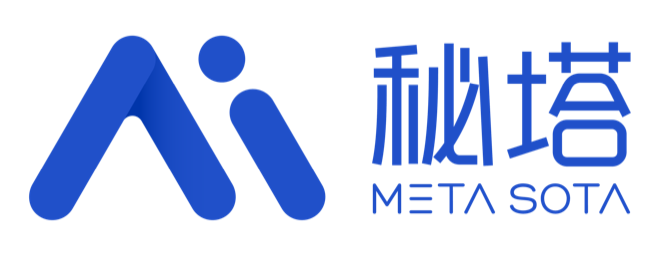
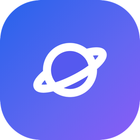
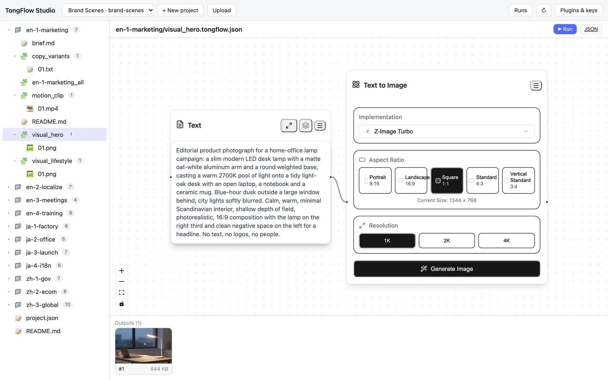
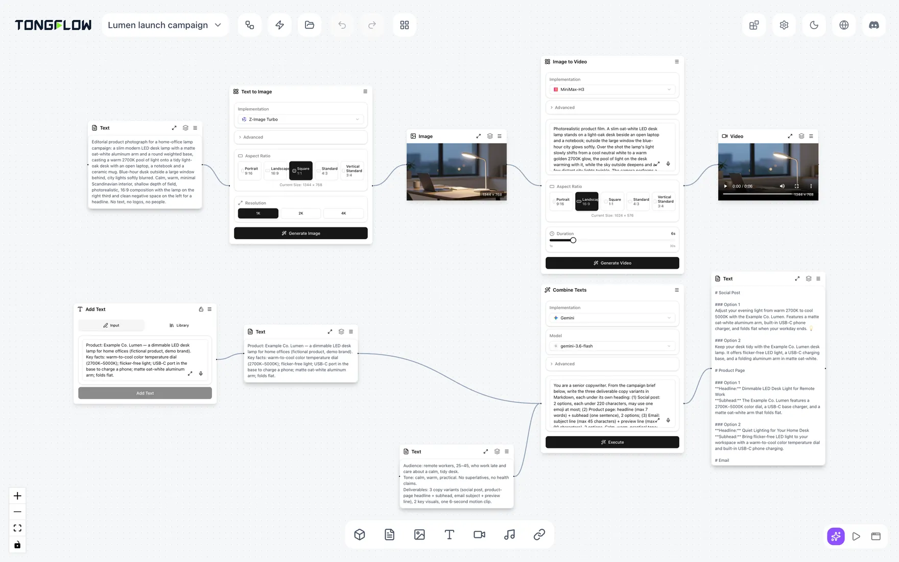
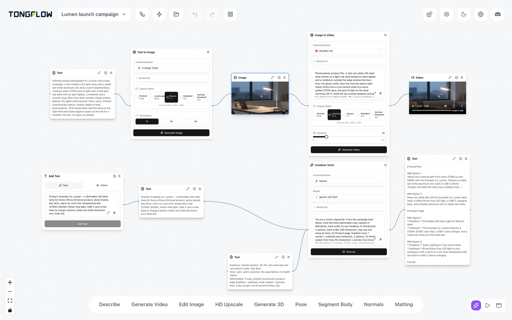
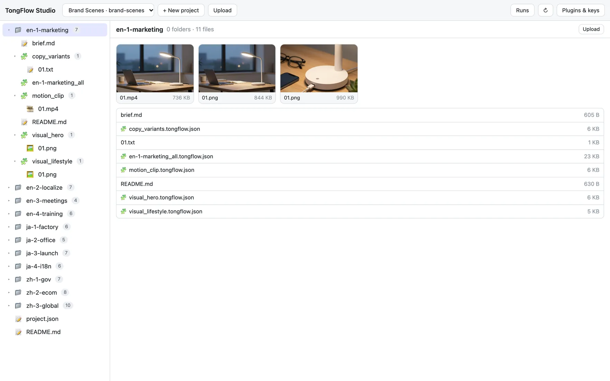

  <picture>
    <source media="(prefers-color-scheme: dark)" srcset="public/brand/tongflow-wordmark-white.svg" />
    
  </picture>

  <h1>TongFlow — Agent-Human-Friendly, Modality-First, Enterprise-Level GenAI Workflow Platform</h1>
  
Open source under the AGPL-3.0, with a commercial license available.

  

    
    
    
    
    
    
  

  

    <strong>English</strong> · <a href="docs/README_ZH.md">简体中文</a> · <a href="docs/README_JA.md">日本語</a>
  

## Sponsors

<table>
  <tr>
    <td width="190" align="center">
      
    </td>
    <td>
      <strong><a href="https://metaso.cn/minimax-h3/?s=TongFlow" target="_blank" rel="noopener noreferrer">Metaso (秘塔科技)</a></strong> — A video generation API that speaks the OpenAI protocol and works with ComfyUI.
    </td>
  </tr>
  <tr>
    <td width="190" align="center">
      
    </td>
    <td>
      <strong><a href="https://www.infistar.cc/register?aff=Y8S76PTA&amp;ref_source=link" target="_blank" rel="noopener noreferrer">Infistar (无限星河AI)</a></strong> — An OpenAI-compatible model gateway: one key covers the text, image, video and transcription nodes on the canvas.
    </td>
  </tr>
</table>

## Where AI stalls at work

- **AI agents:** you can't tell how an agent got its result.
- **People:** most of them still ask one question and get one answer in a chat box.
- **Materials:** images, documents, audio and video each live in a different tool.
- **Managers:** who uses AI, what it costs and where the data goes is hard to say.

## Four strengths

### Agent-Friendly

**Agents work inside a workflow, and every step is recorded.**

- AI agents build workflows with the same tools people use.
- What an agent makes is a workflow file. People can open it, edit it and run it again.
- Each run leaves a record, and a run that costs money waits for a person's approval.

Also available as custom delivery: human confirmation at key steps, and a remote MCP server.

**Result:** what an agent produces can be checked and traced.

### Human-Friendly

**People who don't write code can turn what they know into a workflow.**

- Three actions: add, transform, combine.
- Each step's output stays on the canvas, so you can pick up from a result in the middle.
- A workflow can be reused: run it again with new materials, or hand it to a colleague.

**Result:** your people put AI to work in their own jobs.

### Modality-First

**Start from the material and the result. Choose the model last.**

- Seven modalities — text, images, audio, video, 3D, documents and links — flow on one canvas.
- Capabilities are separate from models, so the implementation behind a step can change.
- More than sixty capabilities and more than fifty official plugins, through commercial APIs, model gateways and open models.

**Result:** change the model, keep the workflow.

### Enterprise-Level

**See it, manage it, look it up later.**

- Deploy TongFlow in your own environment.
- Run history records the workflow, each step, the plugin and model used, inputs and outputs, and the time.
- The core is open source, and models and compute run on your own contracts.

**Custom delivery** — developed and delivered to your requirements as part of a private deployment:

1. Account and identity integration (single sign-on)
2. Role-based permissions
3. Approval before paid runs (request, approve, run)
4. Run logs and audit: query and export by person, workflow and time
5. Remote MCP server, reachable at a URL
6. Human confirmation at key steps
7. Local models, your own compute, and data that stays inside your environment

**Result:** with a private deployment, AI becomes something your organization can govern.

## Putting it to work

**Where teams start**

- **Marketing content** — turn product photos and key points into copy, images, voiceover and short videos.
- **Localization** — carry documents, audio and video into other languages.
- **Meetings and knowledge** — turn recordings and documents into minutes and summaries.
- **Training and communication** — draft scripts, images, narration and short videos for training and internal updates.

**App Mode** turns a finished workflow into a form, so more people can use it. It also opens in a phone browser.

**Two ways to run it**

- **Self-hosting** — run it from source or with Docker. Open source under the AGPL-3.0, with a commercial license available. See the [developer guide](docs/developers.md).
- **Private deployment** — we set up a dedicated workflow platform in your own environment and deliver the custom delivery items to your requirements. [Contact sales](https://www.tongflow.com/en/contact).

**Try it online** at [app.tongflow.com](https://app.tongflow.com). Open it in a browser or the desktop app. There is nothing to deploy. You use your own model API keys and compute accounts. Usage is billed to your accounts, and your data stays with you. We don't sell generation credits. It is for evaluation only, with no guarantees. It is free for 7 days. To keep using it after that, you subscribe inside the product.

## Services

- **Private deployment**
- **Custom nodes and plugins**
- **AI workflow consulting**

How we work together: discovery → proof of concept (PoC) → deployment → rollout.

[Contact sales](https://www.tongflow.com/en/contact) or write to **business@tongflow.com**. For pricing, contact us.

## Open source and license

TongFlow is open source under the AGPL-3.0, an OSI-approved license. A commercial license is available. TongFlow is **dual-licensed**:

- **[AGPL-3.0](LICENSE)**, including its Section 13 network/source-disclosure obligation.
- **[Commercial License](COMMERCIAL-LICENSE.md)** — for organizations that want to use TongFlow in closed-source or SaaS products without AGPL's source-disclosure obligation, or that need warranties and support. Contact **business@tongflow.com**.

This covers the entire repository, including the `sdk/` directory (the `tongflow` PyPI package). Contributions are covered by our [CLA](CLA.md).

## For developers

Setup, the capability list, the official plugins, writing plugins and connecting AI agents: **[docs/developers.md](docs/developers.md)**.
