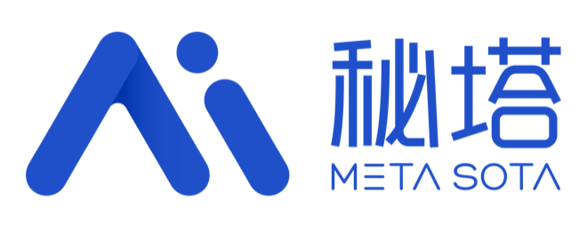
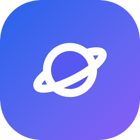
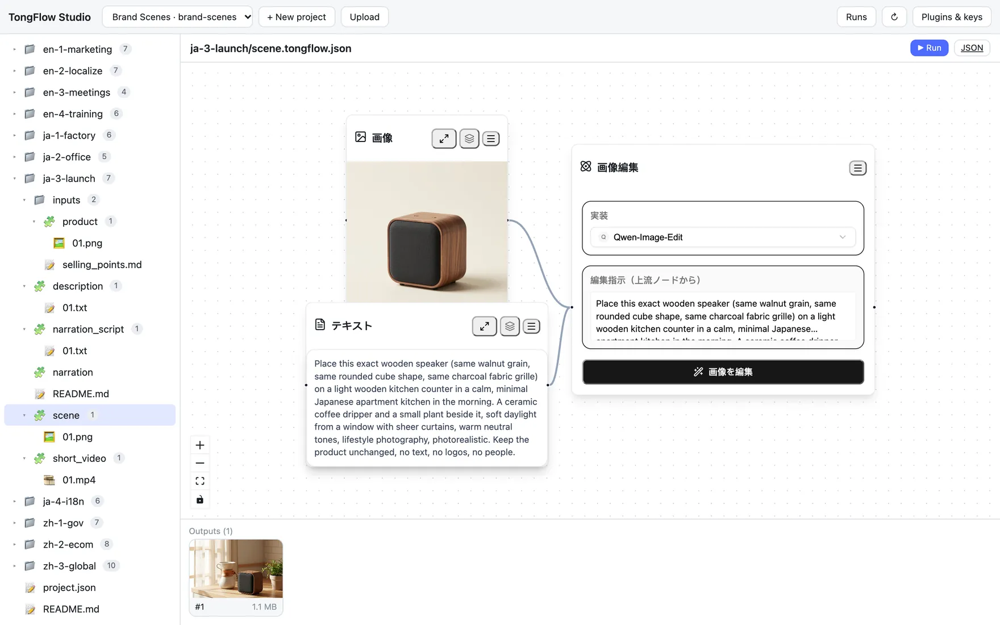
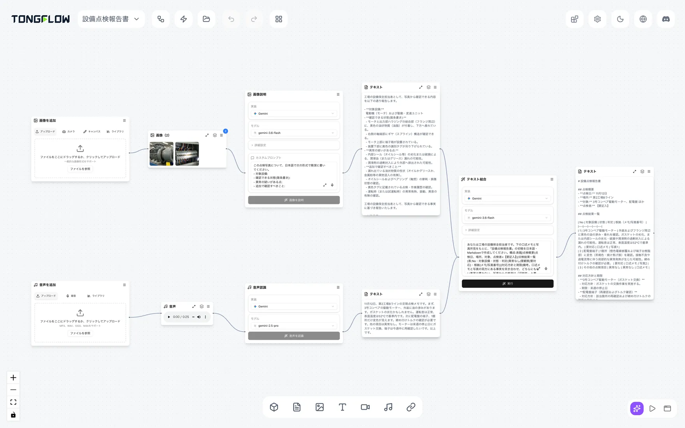
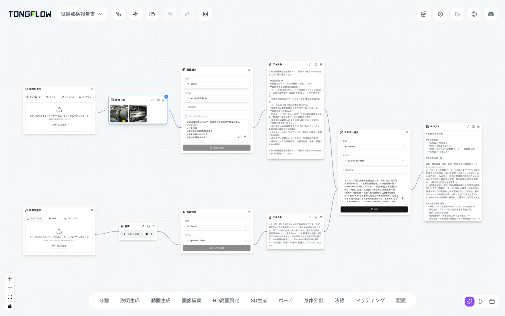
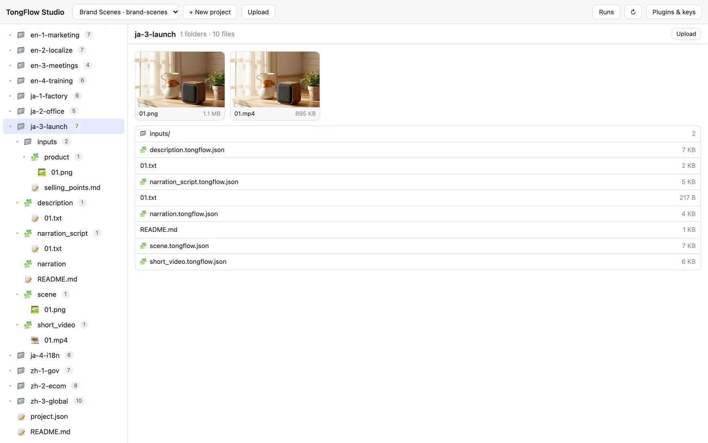

  <picture>
    <source media="(prefers-color-scheme: dark)" srcset="../public/brand/tongflow-wordmark-white.svg" />
    
  </picture>

  <h1>TongFlow — 人とAIエージェントが協働する、モダリティファーストの企業向け生成AIワークフロープラットフォーム</h1>
  
AGPL-3.0のオープンソースです。商用ライセンスもご用意しています。

  

    
    
    
    
    
    
  

  

    <a href="../README.md">English</a> · <a href="README_ZH.md">简体中文</a> · <strong>日本語</strong>
  

## スポンサー

<table>
  <tr>
    <td width="190" align="center">
      
    </td>
    <td>
      <strong><a href="https://metaso.cn/minimax-h3/?s=TongFlow" target="_blank" rel="noopener noreferrer">秘塔科技（Metaso）</a></strong>：OpenAI互換のAPIで使える動画生成サービスです。ComfyUIからも使えます。
    </td>
  </tr>
  <tr>
    <td width="190" align="center">
      
    </td>
    <td>
      <strong><a href="https://www.infistar.cc/register?aff=Y8S76PTA&amp;ref_source=link" target="_blank" rel="noopener noreferrer">无限星河AI（Infistar）</a></strong>：OpenAI互換のモデルゲートウェイです。1つのキーで、キャンバス上のテキスト・画像・動画・文字起こしのノードを使えます。
    </td>
  </tr>
</table>

## 4つの課題

- **AIエージェント**：どのように作業したのか、説明できない。
- **現場の社員**：チャット欄で一問一答するだけで終わってしまう。
- **業務の素材**：画像、文書、音声、動画が、それぞれ別のツールに分かれている。
- **管理者**：誰が使い、いくらかかり、データがどこへ行ったのか、把握できない。

## 4つの強み

### AIエージェント対応 `Agent-Friendly`

**AIエージェントはフローの中で作業し、各ステップが記録されます。**

- AIエージェントと人が、同じツールでフローを組み立てます。
- AIエージェントの成果物はフローのファイルです。人が開いて、修正し、もう一度実行できます。
- 実行のたびに実行履歴が残ります。費用のかかる実行の前には、人の承認を求めます。

個別対応として、重要なステップでの人による確認と、リモートのMCPサーバーもご用意しています。

**結果**：AIエージェントの成果物を、確認・追跡できます。

### 現場で使える `Human-Friendly`

**コードを書かなくても、現場の知見をフローにできます。**

- 3つの操作：追加・変換・組み合わせ。
- 各ステップの結果はキャンバスに残り、途中の結果から続けられます。
- フローは繰り返し使えます。素材を入れ替えて再実行したり、同僚に渡したりできます。

**結果**：社員がAIを使いこなせるようになります。

### モダリティファースト `Modality-First`

**素材と結果から考え、モデルは最後に選びます。**

- テキスト、画像、音声、動画、3D、文書、リンクの7つのモダリティが、1つのキャンバス上でつながります。
- 機能とモデルを分けているため、各ステップの実装を入れ替えられます。
- 60以上の機能と50以上の公式プラグインがあり、商用API、モデルゲートウェイ、オープンモデルを使えます。

**結果**：モデルを替えても、フローはそのままです。

### エンタープライズ対応 `Enterprise-Level`

**見える、管理できる、あとから確認できる。**

- お客様ご自身の環境に導入できます。
- 実行履歴に、フロー、各ステップ、使ったプラグインとモデル、入力と出力、時刻を記録します。
- コアはオープンソースです。モデルと計算資源は、お客様ご自身の契約で使います。

**個別対応**（プライベート導入の際に、お客様の要件に合わせて開発・提供します。）：

1. アカウントと認証の連携（統合認証、シングルサインオン）
2. 段階的な権限管理
3. 有料実行の承認（申請・承認・実行）
4. 実行ログと監査：人・フロー・期間ごとの検索とエクスポート
5. MCPサーバー（URLで利用できるリモートサーバー）
6. 重要なステップでの人による確認
7. ローカルモデルや自社の計算資源との接続、データを社内環境の外に出さない運用

**結果**：プライベート導入により、AIを組織で管理できるようになります。

## 導入と活用

**活用の場面**

- **製造業の現場**：点検の写真と口述メモから、点検報告書の下書きを作ります。
- **自治体・企業の事務**：会議の録音から、議事録とお知らせ文の下書きを作ります。
- **マーケティングと新商品の展開**：商品画像と訴求ポイントから、文案、イメージ画像、ナレーション、短い動画を作ります。
- **海外向け資料・研修資料の多言語化**：資料、音声、動画を複数の言語に展開します。

**アプリモード**：組み立てたフローをフォームにして、より多くの人に使ってもらえます。スマートフォンのブラウザでも開けます。

**2つの使い方**

- **セルフホスト**：ソースコードまたはDockerで導入します。AGPL-3.0のオープンソースで、商用ライセンスもあります。[開発者向けドキュメント（英語）](developers.md)をご覧ください。
- **プライベート導入**：お客様の環境に専用の生成AIワークフロープラットフォームを構築し、個別対応の各項目を要件に合わせて提供します。[導入のご相談](https://www.tongflow.com/ja/contact)。

**オンラインで試す**：[app.tongflow.com](https://app.tongflow.com)。ブラウザまたはデスクトップアプリで開けます。ご自身で環境を構築する必要はありません。モデルのAPIキーと計算資源のアカウントは、お客様ご自身のものを使います。利用料はお客様のアカウントに請求され、データもお客様のもとに残ります。生成クレジットは販売していません。お試し用の環境です。動作の保証はありません。7日間は無料でお試しいただけます。その後も続けて利用する場合は、製品内でのご契約が必要です。

## サービスと進め方

- **プライベート導入**
- **カスタムノード・プラグインの開発**
- **AIフロー構築のコンサルティング**

進め方：要件のヒアリング → 試行検証（PoC）→ 本番導入 → 展開と定着。

[導入のご相談](https://www.tongflow.com/ja/contact)、または**business@tongflow.com**までご連絡ください。費用についてはお問い合わせください。

## オープンソースとライセンス

TongFlowはAGPL-3.0のオープンソースです。商用ライセンスもご用意しています（デュアルライセンス）。

- **[AGPL-3.0](../LICENSE)**：AGPLの各条項（第13条のネットワーク利用時のソース公開義務を含む）に従ってご利用いただけます。
- **[商用ライセンス](../COMMERCIAL-LICENSE.md)**：クローズドソースやSaaSの製品でソース公開義務を負わずに使いたい組織、または保証やサポートが必要な組織向けです。**business@tongflow.com**までご連絡ください。

ライセンスはリポジトリ全体（PyPIの`tongflow`パッケージである`sdk/`ディレクトリを含む）に適用されます。コードの貢献には[CLA](../CLA.md)が適用されます。

## 開発者の方へ

ソースコードやDockerでの起動、機能の一覧、公式プラグイン、プラグインの作り方、AIエージェントとの接続：英語の[開発者向けドキュメント](developers.md)をご覧ください。
