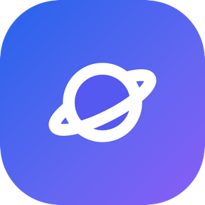

  <picture>
    <source media="(prefers-color-scheme: dark)" srcset="assets/brand/tongflow-zh-wordmark-reverse.svg" />
    
  </picture>

  <h1>通流智汇（TongFlow）— 人机协同、多模态优先的企业级生成式人工智能工作流平台</h1>
  
AGPL-3.0 开源，可选商业许可。

  

    
    
    
    
    
    
  

  

    <a href="../README.md">English</a> · <strong>简体中文</strong> · <a href="README_JA.md">日本語</a>
  

## 赞助商

<table>
  <tr>
    <td width="190" align="center">
      
    </td>
    <td>
      <strong><a href="https://metaso.cn/minimax-h3/?s=TongFlow" target="_blank" rel="noopener noreferrer">秘塔科技</a></strong>：视频生成 API，兼容 OpenAI 协议，也能在 ComfyUI 里用。
    </td>
  </tr>
  <tr>
    <td width="190" align="center">
      
    </td>
    <td>
      <strong><a href="https://www.infistar.cc/register?aff=Y8S76PTA&amp;ref_source=link" target="_blank" rel="noopener noreferrer">无限星河AI</a></strong>：兼容 OpenAI 协议的模型聚合网关，一个 Key 覆盖画布上的文本、图像、视频和转写节点。
    </td>
  </tr>
</table>

## 四个痛点

- **智能体**：它是怎么干的，说不清。
- **一线员工**：只会在对话框里问一句、答一句。
- **业务材料**：图、文、音、视频，各用各的工具。
- **管理者**：谁在用、花了多少、数据去了哪，说不清。

## 四个优势

### 智能体友好 `Agent-Friendly`

**智能体在流程里做事，每一步有记录。**

- 智能体和人用同一套工具搭流程。
- 智能体的产出是流程文件，人能打开、修改、重新运行。
- 每次运行留一份运行记录；运行付费的步骤之前，要先经人同意。

另有企业交付：关键步骤由人确认、远程模型上下文协议（MCP）服务。

**结果**：智能体的产出，可查、可追溯。

### 全员易用 `Human-Friendly`

**不写代码，也能把经验搭成流程。**

- 三个动作：添加、转换、组合。
- 每一步的产出留在画布上，可以从中间的结果接着做。
- 流程可以反复用：换一批材料再运行，也可以交给同事用。

**结果**：员工能活用 AI 了。

### 多模态优先 `Modality-First`

**业务是多模态的，流程也该是一条。先看材料和结果，模型最后再选。**

- 文本、图像、音频、视频、3D、文档、链接七种模态，在一张画布上流转。
- 能力与模型分开，同一种能力的实现可以换。
- 六十多个能力槽位、五十多个官方插件；可接商业接口、模型网关、开源模型，自有算力属企业交付。

**结果**：换模型，不换流程。

### 企业级 `Enterprise-Level`

**看得见，管得住，查得到。**

- 可部署在贵单位的自有环境。
- 运行记录记下流程、每一步、所用的插件和模型、输入与产出、时间。
- 开源内核，模型和算力走贵单位自己的合同。

**企业交付**（随私有化部署，按贵单位的要求开发和交付。）：

1. 账号与认证对接（统一认证、单点登录）
2. 分级权限管理
3. 付费运行需确认（申请、确认、运行）
4. 运行日志与审计：按人、按流程、按时间查询与导出
5. MCP 服务（带网址的远程服务）
6. 关键步骤由人确认
7. 本地模型、自有算力对接，数据不离开企业环境

**结果**：随私有化部署，AI 能治理了。

## 落地

**先让一项业务跑起来**

- **政务与国企办公**：把会议录音和文件材料整理成纪要、通知和汇报的初稿。
- **电商与品牌营销**：从商品图和卖点出发，做文案、场景图、配音和短视频。
- **企业出海**：把产品资料、宣传视频和培训材料转成多种语言。

**App Mode（表单模式）**：把搭好的流程变成表单，推广给更多人用。手机浏览器里也能打开。

**两种用法**

- **自行部署**：用源代码或 Docker 部署。AGPL-3.0 开源，可选商业许可。见[开发者文档（英文）](developers.md)。
- **私有化部署**：我们在贵单位的自有环境中搭建专属的工作流平台，并按需交付企业交付的各项能力。[商务咨询](https://www.tongflow.com/zh/contact)。

**在线体验**：[app.tongflow.com](https://app.tongflow.com)。在浏览器或桌面端打开，不用自己部署。模型的钥匙和算力账号用您自己的，账单和数据都归您。我们不卖生成积分。仅供体验，不作任何保证。可免费体验 7 天；之后继续使用，需在产品内订阅。

## 服务与合作

**从设计到运营，一起做**

- **私有化部署**
- **定制节点与插件开发**
- **AI 工作流搭建咨询**

合作分四步：需求调研 → 试点验证（PoC）→ 正式部署 → 推广与落地。

[商务咨询](https://www.tongflow.com/zh/contact)，或发邮件到 **business@tongflow.com**。费用请联系我们。

## 开源与许可

通流智汇以 AGPL-3.0 开源，可选商业许可（双许可）：

- **[AGPL-3.0](../LICENSE)**：须遵守 AGPL 的全部条款，包括第 13 条的网络使用与源代码公开义务。
- **[商业许可](../COMMERCIAL-LICENSE.md)**：适合要在闭源或 SaaS 产品中使用、又不想承担 AGPL 源代码公开义务，或需要质保和技术支持的单位。请联系 **business@tongflow.com**。

许可覆盖整个仓库，包括 `sdk/` 目录（PyPI 上的 `tongflow` 包）。贡献代码需签署 [CLA](../CLA.md)。

## 给开发者

从源代码或 Docker 启动、能力清单、官方插件、自己写插件、接入智能体：见英文的 **[开发者文档](developers.md)**。
